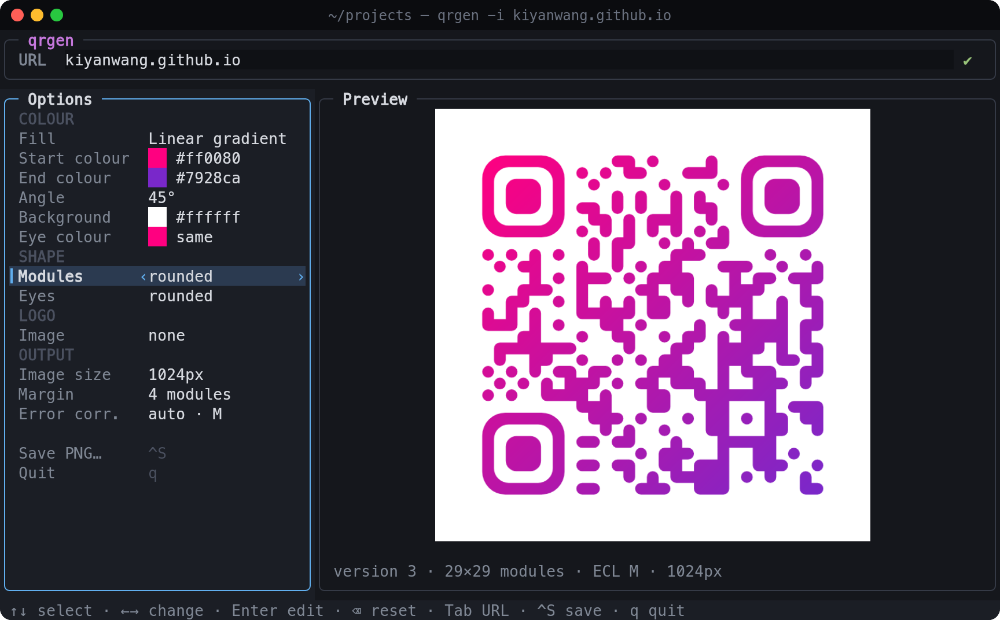
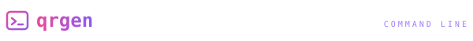
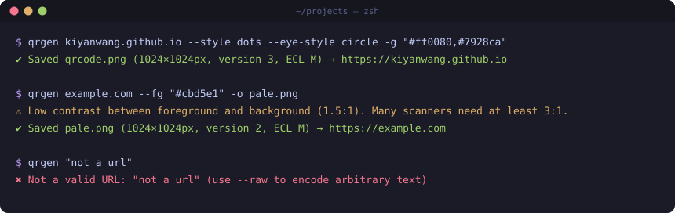
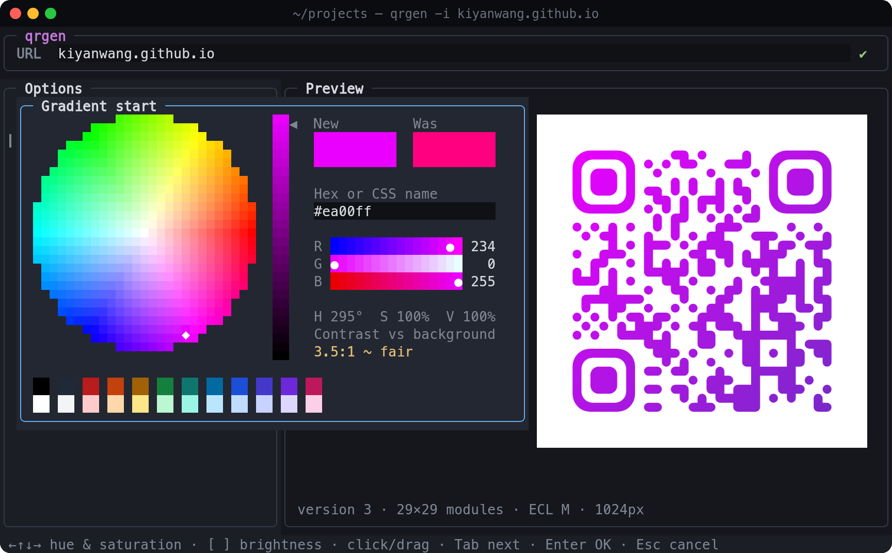
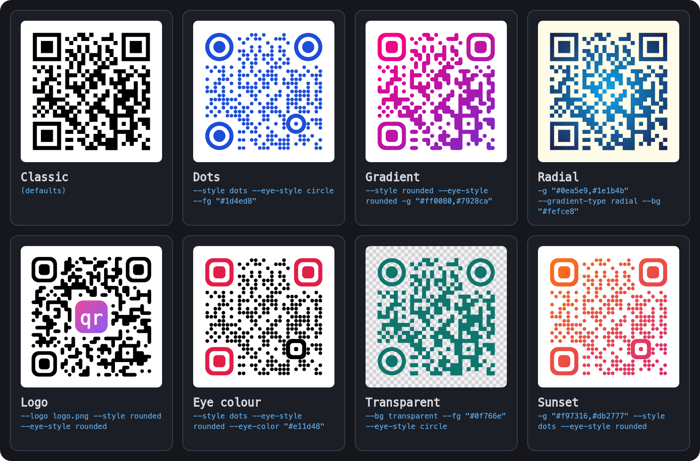
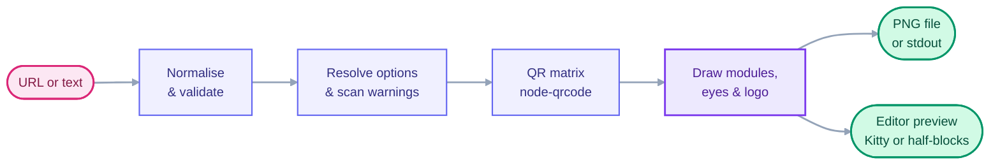

<div align="center">


### style it, preview it, scan it

_Turn any URL into a QR code PNG, styled your way, from one command or a full-screen editor_

[](https://nodejs.org)
[](#command-line)
[](#styles)
[](#editor)
[](#development)

**[Install](#install) · [Command line](#command-line) · [Editor](#editor) · [Colours](#colours) · [Styles](#styles) · [Options](#options) · [How it works](#how-it-works) · [About](#about)**

<br/>



</div>

> `qrgen` makes QR codes without leaving your terminal. Give it a URL and you get a PNG. Run it on its own and you get an editor: pick colours from a wheel, try shapes and logos, and watch the real code update as you go. Every style it makes is checked by an independent QR reader in the tests, so a code that looks good also scans.

## At a glance

| You want to…                        | Run                                                       |
| ----------------------------------- | --------------------------------------------------------- |
| A QR code for a URL                 | `qrgen example.com`                                       |
| Design one in the editor            | `qrgen`                                                   |
| Open the editor with a starting style | `qrgen -i example.com --style dots`                     |
| Use brand colours                   | `qrgen example.com -g "#ff0080,#7928ca" --style rounded`  |
| Put a logo in the middle            | `qrgen example.com --logo logo.png`                       |
| Print it big on any background      | `qrgen example.com -s 4096 --bg transparent`              |
| Share Wi-Fi, or any other text      | `qrgen "WIFI:T:WPA;S:Home;P:secret;;" --raw`              |
| Pipe it somewhere                   | `echo https://example.com \| qrgen -o - > code.png`        |

## Install

```bash
git clone git@github.com:kiyanwang/qrgen.git
cd qrgen
npm install     # also builds dist/
npm link        # puts `qrgen` on your PATH
```

Needs **Node.js 22.18+**. Rendering uses Skia through prebuilt [`@napi-rs/canvas`](https://github.com/Brooooooklyn/canvas) binaries, so there is nothing to compile and nothing else to install.

<h2 id="command-line"></h2>

```bash
qrgen example.com                       # → qrcode.png (https:// added)
qrgen example.com -o site.png -s 2048   # name and size
qrgen example.com --fg "#1e3a8a" --style dots --eye-style circle
qrgen example.com -g "#ff0080,#7928ca" --gradient-type radial
qrgen example.com --logo logo.png --bg transparent
qrgen example.com --preview             # also show it in the terminal
```

<p align="center"></p>

`qrgen` still saves the file when it warns, but it tells you about choices that commonly stop phones reading a code:

| Warning              | Raised when                                                      |
| -------------------- | ---------------------------------------------------------------- |
| Low contrast         | any foreground, gradient stop or eye colour is under 3:1 against the background |
| Inverted             | the foreground is lighter than the background                    |
| Small margin         | the quiet zone is under 2 modules                                |
| Logo without high error correction | `--logo` is used with `-e L`, `M` or `Q`           |
| Transparent background | as a reminder to check what the code will sit on               |

Input can come from stdin, and `-o -` writes the PNG to stdout, so `qrgen` slots into scripts. Errors go to stderr with exit code `1`.

<h2 id="editor"></h2>

```bash
qrgen                                      # start from scratch
qrgen -i example.com --style dots          # start from a URL and some options
```

A URL bar across the top, options down the left, and the code in the middle. In **Ghostty, Kitty and WezTerm** the preview is the actual PNG, drawn inline with the Kitty graphics protocol. Other terminals get a version drawn with coloured half-block characters that still shows shapes, gradients and logos. The preview updates while a popup is open, so you see a colour before you commit to it.

| Key                      | Does                                                        |
| ------------------------ | ----------------------------------------------------------- |
| `↑` `↓` / `j` `k`        | Move through the options                                    |
| `←` `→` / `h` `l`        | Change the selected value in place                          |
| `enter` · `space` · click | Open its popup: colour picker, list, file browser or prompt |
| `⌫` · `delete`           | Reset eye colour, logo or error correction                  |
| `tab` · `/`              | Jump to the URL bar and back                                |
| `ctrl-s`                 | Save the PNG, asking before it overwrites anything          |
| `q` · `ctrl-c`           | Quit and print the equivalent `qrgen` command               |

When you quit, `qrgen` prints the one-line command that recreates your design, so anything you build in the editor can go straight into a script.

<h2 id="colours"></h2>

<p align="center"></p>

No hex codes required. Every control works with the mouse or the keyboard, and `tab` moves between them.

| Control              | Mouse                    | Keys                                              |
| -------------------- | ------------------------ | ------------------------------------------------- |
| Hue · saturation wheel | click or drag          | `←` `↑` `↓` `→`, hold `shift` for bigger steps    |
| Brightness bar       | click, drag or scroll    | `↑` `↓`, or `[` `]` from anywhere in the picker   |
| R · G · B sliders    | click or scroll          | `←` `→` ±1, `shift` ±16, `home` / `end`           |
| Hex or name          | click to edit, or paste  | `#1d4ed8`, `teal`, `rgb(30 58 138)`, `hsl(…)`     |
| Palette              | click a swatch           | arrows. Dark row for codes, light row for backgrounds |
| Transparent          | click (background only)  | `space`                                           |

The **New / Was** swatches show what you are changing from, and the contrast readout against the other colour turns amber below 4:1 and red below 3:1. `enter` keeps the colour, `esc` puts the old one back.

<h2 id="styles"></h2>

<p align="center"></p>

Every code above encodes [kiyanwang.github.io](https://kiyanwang.github.io), so point your phone at any of them. The script that draws them (`npm run docs:art`) decodes each one first and stops if any fails to scan.

- **Modules:** `square`, `dots` or `rounded`. Rounded modules merge with their neighbours into smooth runs.
- **Eyes:** the three corner squares can be `square`, `rounded` or `circle`, with their own `--eye-color`.
- **Fills:** a solid colour, or a `linear` gradient at any `--gradient-angle`, or a `radial` one.
- **Logos:** PNG, JPEG, SVG, WebP or GIF, centred, with the modules underneath cleared. Error correction goes up to `H` automatically.

## Options

| Flag                       | Default            |                                                         |
| -------------------------- | ------------------ | ------------------------------------------------------- |
| `-o, --output <file>`      | `qrcode.png`       | `-` writes to stdout                                    |
| `-s, --size <px>`          | `1024`             | 64 to 8192                                              |
| `-m, --margin <modules>`   | `4`                | the quiet zone; keep it at 2 or more                    |
| `--fg <colour>`            | `#000000`          | any CSS colour                                          |
| `--bg <colour>`            | `#ffffff`          | any CSS colour, or `transparent`                        |
| `-g, --gradient <from,to>` |                    | replaces `--fg`                                         |
| `--gradient-type`          | `linear`           | `linear` or `radial`                                    |
| `--gradient-angle <deg>`   | `45`               | `0` is left to right, `90` is top to bottom             |
| `--style`                  | `square`           | `square`, `dots` or `rounded`                           |
| `--eye-style`              | `square`           | `square`, `rounded` or `circle`                         |
| `--eye-color <colour>`     | the foreground     |                                                         |
| `--logo <file>`            |                    | centred; the modules behind it are cleared              |
| `--logo-size <fraction>`   | `0.22`             | 0.05 to 0.3 of the code's width                         |
| `-e, --ecl`                | `M`, or `H` with a logo | `L` 7% · `M` 15% · `Q` 25% · `H` 30% recoverable   |
| `--raw`                    |                    | encode the text exactly as given, without URL checks    |
| `-p, --preview`            |                    | also print the code in the terminal                     |
| `-i, --interactive`        |                    | open the editor, pre-filled with the other options      |
| `-q, --quiet`              |                    | errors only                                             |

Set `QRGEN_PREVIEW=kitty` or `text` to override how previews are drawn. Inside tmux or screen, inline images are skipped.

## How it works



`node-qrcode` decides which modules are dark. `qrgen` draws everything else itself on a Skia canvas: one path for all the modules, so neighbours never show seams; the three eyes as separate shapes; and the logo over a cleared, centred block of modules. Phones find a code by its eyes and alignment patterns. In `dots` mode those alignment patterns are drawn solid, because separate dots made them unreadable to some scanners.

## Development

```bash
npm test             # 66 tests, including every style decoded back with jsQR
npm run typecheck
npm run docs:art     # regenerate the README artwork in docs/
```

```
src/cli.ts              CLI: flags, help, stdin and stdout
src/options.ts          validation, defaults and scan warnings
src/matrix.ts           QR matrix and pattern positions
src/render.ts           the renderer: shapes, gradients, eyes, logo
src/preview.ts          terminal previews: Kitty images, half-block pixels
src/tui/                the editor: screen buffer, input, layout
src/tui/widgets/        colour picker, file browser, lists, prompts
scripts/readme-art.ts   draws docs/ from the real renderer and editor
test/                   unit, CLI, editor and scan tests
```

<a id="about"></a>
## About

Built by **Nadeem Shabir**.

→ [kiyanwang.github.io](https://kiyanwang.github.io)
→ [github.com/kiyanwang](https://github.com/kiyanwang)

QR encoding by [node-qrcode](https://github.com/soldair/node-qrcode). Rendering by [Skia](https://skia.org) via [@napi-rs/canvas](https://github.com/Brooooooklyn/canvas). Scan checks by [jsQR](https://github.com/cozmo/jsQR).
